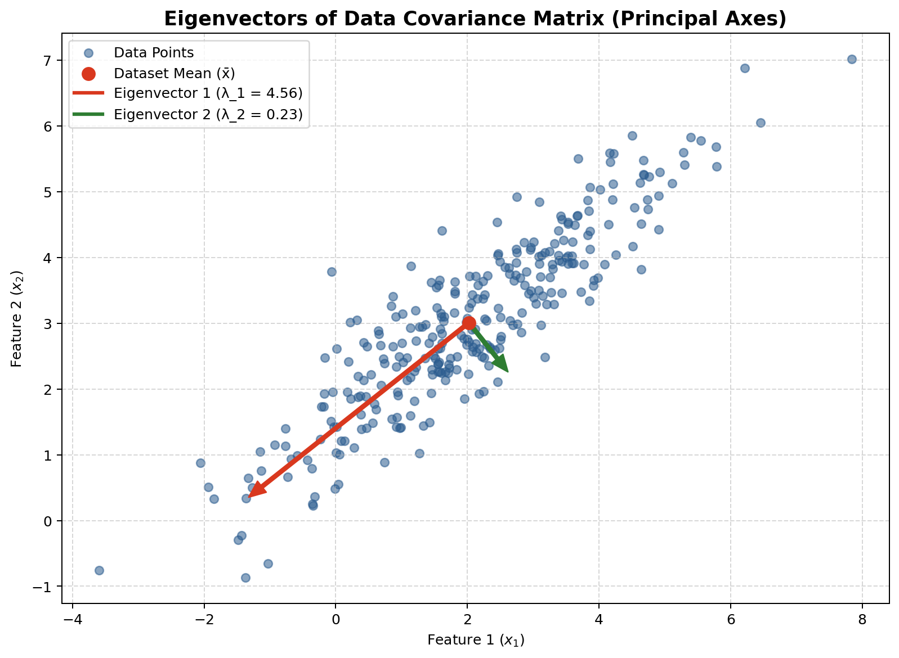

# Eigenvectors and Principal Axes

This document explains [`Eigens.py`](./Eigens.py), a small NumPy and Matplotlib example that generates correlated two-dimensional data, computes its covariance matrix and eigendecomposition, and plots the data with its principal axes.

## What the script does

The script:

1. Generates 300 points from a two-dimensional normal distribution with mean
   $$\mu = \begin{bmatrix}2 \\ 3\end{bmatrix}$$
   and covariance matrix
   $$\Sigma_{\text{true}} = \begin{bmatrix}3.0 & 2.2 \\ 2.2 & 2.0\end{bmatrix}.$$
2. Calculates the sample mean and subtracts it from each point to center the data.
3. Calculates the sample covariance matrix of the centered data.
4. Finds the covariance matrix's eigenvalues and eigenvectors, then sorts them from largest eigenvalue to smallest.
5. Plots the points, their mean, and arrows showing the principal directions.

The random seed is set to `42`, so the generated dataset and plot are reproducible when using the same NumPy behavior and version.

## The mathematics, step by step

### 1. Covariance describes spread and correlation

For data with two features, the covariance matrix has the form

$$
\Sigma =
\begin{bmatrix}
\operatorname{Var}(x_1) & \operatorname{Cov}(x_1,x_2) \\
\operatorname{Cov}(x_1,x_2) & \operatorname{Var}(x_2)
\end{bmatrix}.
$$

The diagonal entries describe each feature's variance. The off-diagonal entries describe how the two features vary together. Here, the positive off-diagonal value indicates that larger values of one feature tend to occur with larger values of the other.

For centered observations, the script uses `numpy.cov(..., rowvar=False)`. With observations as rows, this calculates the sample covariance matrix, dividing by the number of observations minus one.

### 2. Eigenvectors give the principal directions

An eigenvector $u$ of a matrix $\Sigma$ satisfies

$$
\Sigma u = \lambda u,
$$

where $\lambda$ is its eigenvalue. For a covariance matrix:

- The eigenvector gives a direction in the feature plane.
- Its eigenvalue gives the variance of the data when measured along that direction.
- The eigenvector with the largest eigenvalue is the direction with the greatest spread (the first principal component).
- The other eigenvector is perpendicular to it and describes the remaining spread.

`numpy.linalg.eigh` is used because a covariance matrix is symmetric. The returned eigenvectors are unit length. The script sorts the results in descending eigenvalue order so the first direction is the one with the greatest variance.

### 3. What the plotted arrows mean

For each eigenvector $u_i$ and eigenvalue $\lambda_i$, the script plots an arrow from the sample mean to

$$
\bar{x} + 2\sqrt{\lambda_i}\,u_i.
$$

The square root of the eigenvalue is the standard deviation along that direction. Multiplying it by two makes the direction and relative spread easier to see. The arrows show only the positive direction of each axis; a principal axis extends in both directions.

Eigenvectors can be multiplied by $-1$ and still be valid eigenvectors for the same eigenvalue. Therefore, an arrow may point the opposite way in another valid run or implementation without changing the principal axis.

## Values from this run

For the seed and settings in the script, the sample calculations are approximately:

$$
\bar{x} \approx \begin{bmatrix}2.0234 \\ 3.0084\end{bmatrix},
\qquad
\Sigma \approx
\begin{bmatrix}
2.8882 & 2.1096 \\
2.1096 & 1.9008
\end{bmatrix}.
$$

The eigenvalues, in descending order, are approximately

$$
\lambda_1 \approx 4.5611,
\qquad
\lambda_2 \approx 0.2279.
$$

The first eigenvalue is much larger than the second, so the data spread substantially more along the first principal direction.

## How to run it

Install the required packages if they are not already available:

```bash
python3 -m pip install numpy matplotlib
```

Run the script from this folder:

```bash
python3 Eigens.py
```

A Matplotlib window will open with the scatter plot and principal-axis arrows. To generate a plot file in a headless environment, run:

```bash
MPLBACKEND=Agg python3 -c "import runpy; import matplotlib.pyplot as plt; runpy.run_path('Eigens.py'); plt.savefig('Eigens_output.png', dpi=180, bbox_inches='tight')"
```

## Program output

The image below is the plot generated from this script:



## Project files

- [`Eigens.py`](./Eigens.py) — generates the data, computes the covariance eigendecomposition, and displays the plot.
- [`Eigens_output.png`](./Eigens_output.png) — saved plot output embedded above.
- [`Eigens.md`](./Eigens.md) — this explanation.
