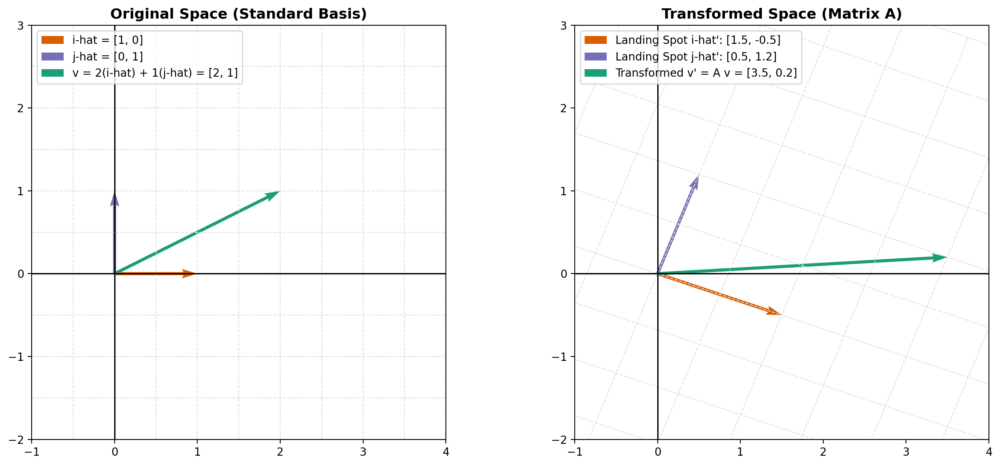

# Vector Transformation Visualization

This project visualizes how a 2D linear transformation acts on the standard basis vectors and a vector in the plane. The script plots both the original coordinate system and the transformed coordinate system side by side.

## What the script does

The script:

- defines the standard basis vectors
  - \( e_1 = \begin{bmatrix} 1 \\ 0 \end{bmatrix} \)
  - \( e_2 = \begin{bmatrix} 0 \\ 1 \end{bmatrix} \)
- defines a target vector
  - \( v = \begin{bmatrix} 2 \\ 1 \end{bmatrix} \)
- defines a transformation matrix
  - \( A = \begin{bmatrix} 1.5 & 0.5 \\ -0.5 & 1.2 \end{bmatrix} \)
- computes where the basis vectors and target vector land after transformation
  - \( A e_1 = \begin{bmatrix} 1.5 \\ -0.5 \end{bmatrix} \)
  - \( A e_2 = \begin{bmatrix} 0.5 \\ 1.2 \end{bmatrix} \)
  - \( Av = \begin{bmatrix} 3.5 \\ 0.2 \end{bmatrix} \)
- draws a Matplotlib figure with two panels:
  - original space
  - transformed space

## Basic mathematics behind the code

A linear transformation in 2D is represented by a 2x2 matrix. Applying the matrix to a vector changes both its direction and possibly its length.

For this example:

\[
A = \begin{bmatrix} 1.5 & 0.5 \\ -0.5 & 1.2 \end{bmatrix}, \quad
v = \begin{bmatrix} 2 \\ 1 \end{bmatrix}
\]

The original vector can be written as a combination of the basis vectors:

\[
v = 2e_1 + 1e_2
\]

Applying the matrix gives:

\[
Av = 2Ae_1 + Ae_2
\]

And since:

\[
Ae_1 = \begin{bmatrix} 1.5 \\ -0.5 \end{bmatrix}, \quad
Ae_2 = \begin{bmatrix} 0.5 \\ 1.2 \end{bmatrix}
\]

we get:

\[
Av = 2\begin{bmatrix} 1.5 \\ -0.5 \end{bmatrix}
+ \begin{bmatrix} 0.5 \\ 1.2 \end{bmatrix}
= \begin{bmatrix} 3.5 \\ 0.2 \end{bmatrix}
\]

This is exactly what the script visualizes: the basis vectors and the vector \(v\) are shown before and after the transformation.

## How to run it

From the project folder, run:

```bash
python3 vector_transform.py
```

If you are using a headless environment and do not want a GUI window, you can use:

```bash
MPLBACKEND=Agg python3 vector_transform.py
```

## Output of the program

Running the script produces a two-panel Matplotlib plot:

- left panel: original space with the standard basis vectors and vector \(v\)
- right panel: transformed space showing the image of the basis vectors and transformed vector



## Files in this project

- `vector_transform.py` — script that generates the visualization
- `vector_transform_output.png` — generated output image saved from the program
- `README.md` — project documentation

## Requirements

Make sure the following Python packages are installed:

```bash
pip install numpy matplotlib
```
